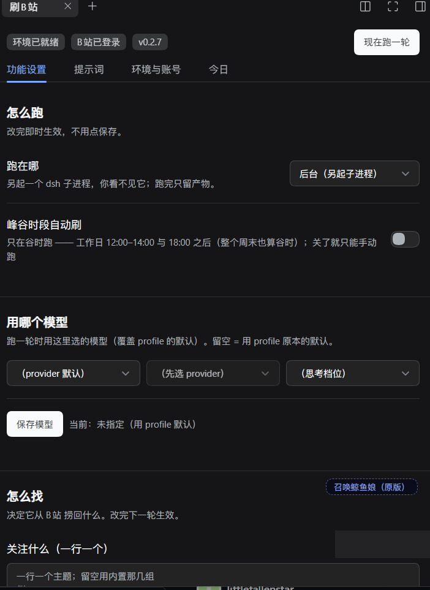
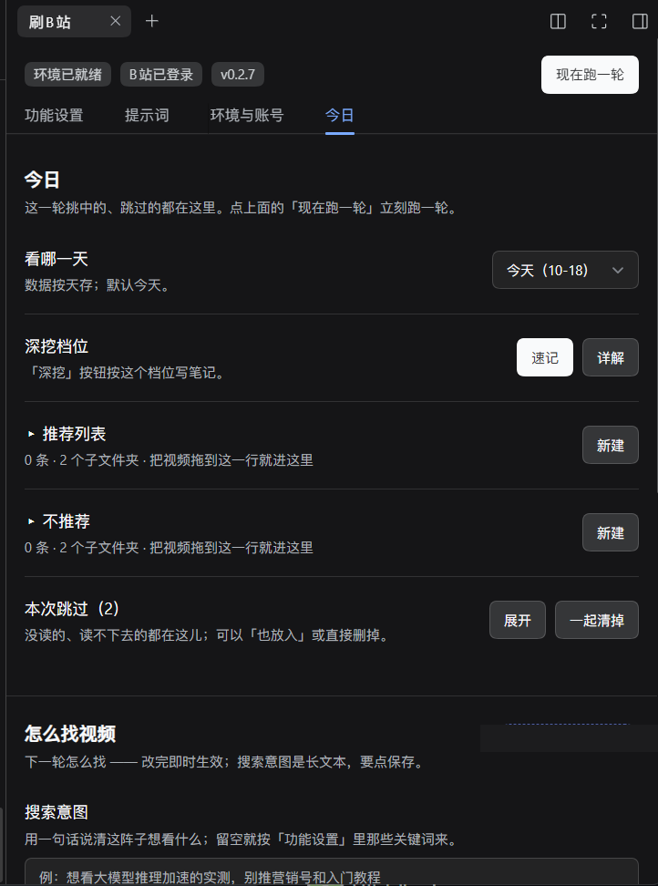
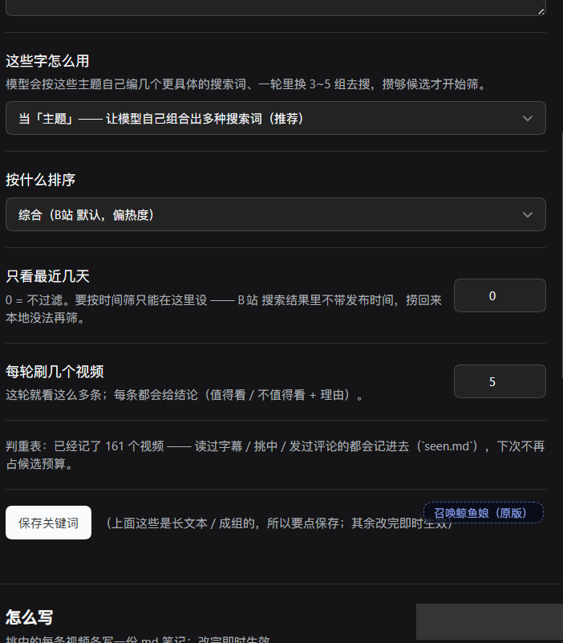
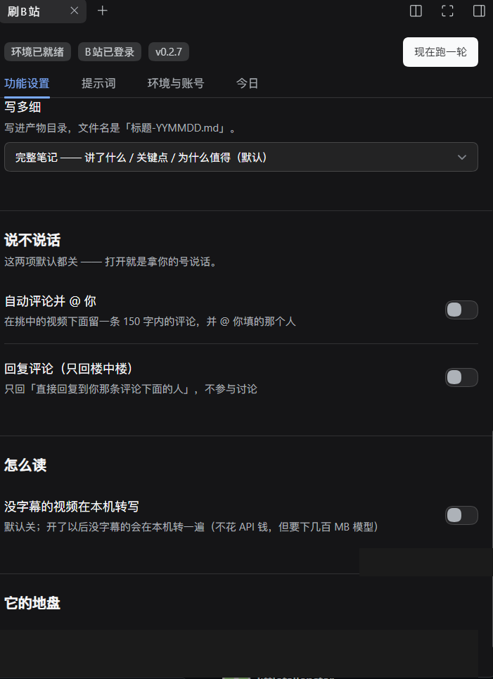

# dsh-bili-scroll ｜ 刷B站

> **DSH 插件**：每天替你刷一轮 B 站 —— 自己搜、**读字幕原文**判断、每条都写结论，
> 把**这一轮的总结**发到你的邮箱 / Obsidian，推荐的顺手加进「稍后再看」。

> 面板在**右侧栏** →「刷B站」，四个标签页：功能设置 / 提示词 / 环境与账号 / 今日。

## 长什么样

| 功能设置 | 今日（推荐 / 不推荐 分轮次） |
|---|---|
|  |  |

| 怎么找（关键词 / 排序 / 每轮几条） | 写多细、说不说话 |
|---|---|
|  |  |

---

## 它每天做什么

```
搜（按你的关键词 / 搜索意图，1~2 组词）
  → 捞回 N 条候选（默认 5 条，跨组去重）
  → 逐条读字幕原文，判断值不值得看
  → 每条写一份笔记 + 一个结论（✅ 值得看 / ❌ 不值得看 + 理由）
  → 发一封「这一轮」的总结邮件（可选同时写 Obsidian）
  → 推荐的加进 B站「稍后再看」
  → 待看被你看空 ⇒ 自动再刷下一轮（可关）
```

**两个口径（这版的重点）：**

1. **「每轮刷几个视频」= 5，就真的看 5 条**，每条都给结论 —— 不凑数、也不偷偷多刷；
2. **每轮只发这一轮的总结**，不叠加：邮件一封一封来，Obsidian 一天里也按轮次分开。

## 面板有什么

右侧栏 →「刷B站」，四个标签页：

| 页 | 能做什么 |
|---|---|
| **功能设置** | 跑在哪（后台 / 前台）、每轮刷几个、搜索意图、排序、只看最近几天、自动评论 / 回复 / 点赞、本地转写、自动续刷 |
| **提示词** | 主题、人设、篇幅；改完即时生效 |
| **环境与账号** | 装依赖、扫码登录 B站、**配邮箱（授权码）**、**配 Obsidian**、看产物 / 打开家目录 |
| **今日** | 今天刷到的视频：推荐列表 / 不推荐，各自按「第 N 轮」分层；可新建文件夹、拖动归类、深挖写详细笔记、删除；底部是「本次跳过」 |

## 邮件与 Obsidian（可选）

- **邮箱**：QQ 邮箱用「授权码」而不是登录密码（设置页有图文步骤）。
  面板「环境与账号 → 邮箱」里填发件邮箱 / 授权码 / 收件人，点「发一封测试」验证。
- **Obsidian**：填库路径（面板有「自动探测」），产物写到 `<库>/B站日报/<日期>/round-<HHMM>.md`。
  **不用 Obsidian 也完全没问题** —— 两个都是可选，不填就不发 / 不写。

> 详细步骤：[`docs/配置指南.md`](docs/配置指南.md)

## 待看与自动续刷

- 推荐的视频会被加进你 B站的**「稍后再看」**（开关在「功能设置」）。
- 「稍后再看」被清空 ⇒ 判定你看完了 ⇒ **自动再刷一轮**。
  - 间隔默认 5 分钟；「最多续刷几轮」填 0 = 不限；
  - 一轮里**一条推荐都没加**时不会触发续刷（否则会空转烧钱）；
  - **同一时间只允许一轮在跑**（重复点「现在跑一轮」会被挡掉）。

## 装

需要 **DSH ≥ 0.1.7-rc.1**，装完**重启一次**（插件在 bundle 层组装，重载页面不算）。

```
把仓库放到：<DSH_HOME>/profiles/desktop/node_modules/dsh-bili-scroll
重启 DSH → 右侧栏出现「刷B站」→ 环境与账号 → 装依赖 / 扫码登录
```

- **依赖镜像**：内置安装脚本用清华源（部分地区 403）。装不动时把环境变量
  `BILI_DUTY_PIP_MIRROR` 指到别家（如 `https://mirrors.aliyun.com/pypi/simple`）。
- **没字幕的视频**默认跳过；要本机转写需额外下 Whisper 模型（几百 MB ~ 1 GB）。

## 数据在哪

| 内容 | 路径 |
|---|---|
| 配置 | `<DSH_HOME>/bili-duty/config.json` |
| 今日列表 | `<DSH_HOME>/bili-duty/today/<日期>.json` |
| 每条视频的笔记 | `<DSH_HOME>/bili-duty/reports/<标题>-<YYMMDD>.md` |
| 每轮的总结（邮件正文同源） | `<DSH_HOME>/bili-duty/out/<日期>/round-<HHMM>.md` |
| 运行日志 | `<DSH_HOME>/bili-duty/duty.log` |
| 判重表 | `<DSH_HOME>/bili-duty/seen.md` |

**删掉某条笔记的 .md，那条视频也会从「今日」列表里消失**（列表以磁盘为准）。

## 常见问题

- **设置页里找不到「刷B站」**：它在**右侧栏**，不在设置列表里。
- **没收到邮件**：先看「环境与账号 → 邮箱」的发测试结果，再看 `duty.log` 里有没有
  `发信成功` / `发信跳过：邮箱没开`。
- **面板一直显示「正在后台运行」**：单轮有 45 分钟上限；真卡住时看日志最后几行。
- **点了「现在跑一轮」没反应**：多半是上一轮还没结束（会提示"上一轮还在跑"）。

## 这版从哪来

上游 [jojoman2024/dsh-bili-scroll](https://github.com/jojoman2024/dsh-bili-scroll)
→ 再上游 [c1overzz/dsh-bili-scroll](https://github.com/c1overzz/dsh-bili-scroll)。

这一支在 0.1.4 之上做了：今日列表与文件夹分级、每轮总结（邮件 / Obsidian）、
稍后再看联动与自动续刷、单轮闸、跳过留痕、深挖写详细笔记。

- 逐版变动：[`CHANGELOG.md`](CHANGELOG.md)
- 为什么这么改（含踩过的坑）：[`docs/开发日志.md`](docs/开发日志.md)

## License

MIT
